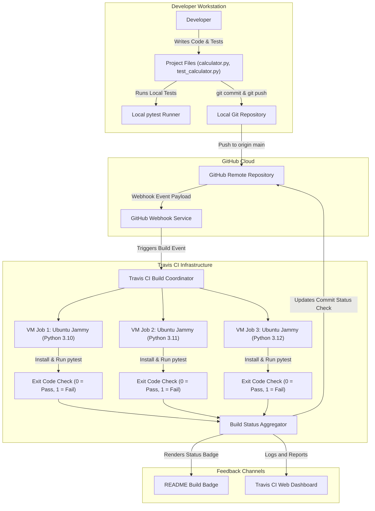
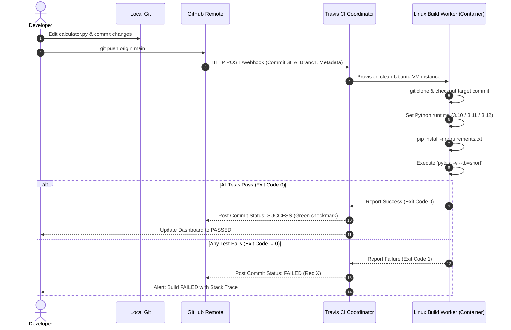

# Demonstration of Continuous Integration (CI) Using Travis CI
## A Comprehensive College Project Report and Practical Laboratory Study

---

## 1. Title
**Design and Implementation of an Automated Continuous Integration (CI) Pipeline Using Travis CI and Pytest for Software Quality Assurance**

---

## 2. Abstract
In traditional software development methodologies, integrating disparate software components and running regression test suites is performed manually near the culmination of the development cycle. This paradigm frequently results in the phenomenon termed "integration hell," where hidden bugs, merge collisions, and environment-specific incompatibilities compound, causing significant delivery delays and elevated defect remediation expenses.

This project demonstrates the design, deployment, and practical evaluation of a modern **Continuous Integration (CI)** pipeline using **Travis CI**, **GitHub**, and **Python (pytest)**. Using a clean arithmetic computation module as the subject system, an automated test suite comprising 18 unit and edge-case verification checks was constructed. A declarative configuration file (`.travis.yml`) coordinates virtualized build environments on Ubuntu 22.04 LTS across multiple Python versions (3.10, 3.11, 3.12). 

The experimental demonstration verifies that every code push and pull request directly triggers automated linting, installation, and testing cycles within an isolated container. The pipeline immediately surfaces regressions and halts build progression upon the introduction of deliberate code defects, confirming the efficacy of CI in enforcing software reliability and shortening the developer feedback loop.

---

## 3. Introduction
Continuous Integration is one of the pillars of modern DevOps engineering. It represents a cultural and technical practice wherein software developers merge code modifications into a central version control repository several times per day. Rather than treating integration as an isolated event at the end of a milestone, integration becomes a routine, automated occurrence.

A robust Continuous Integration system consists of three main components:
1. **Source Code Management (SCM)**: A distributed version control platform such as Git and GitHub to host repositories and emit event webhooks upon push or pull-request activities.
2. **Automated Test Suite**: A suite of repeatable, deterministic test scripts that exercise functional units, boundary limits, and error scenarios.
3. **CI Automation Server / Cloud Engine**: A hosted execution engine (e.g., Travis CI) that listens for SCM events, provisions clean build instances, checks out code, runs builds, and reports status.

This project delivers a practical, hands-on demonstration of this loop tailored for college-level DevOps and software engineering coursework.

---

## 4. Problem Statement
In academic software projects and traditional waterfall environments, software verification is plagued by several core problems:
1. **Late Defect Discovery**: Code errors committed early in the project remain undetected until manual testing takes place weeks later.
2. **"It Works On My Machine" Dilemma**: Software functioning on an individual developer's local workstation frequently fails on peer systems or production servers due to unmanaged dependencies and configuration drift.
3. **High Remediation Costs**: Diagnosing a bug buried beneath dozens of subsequent commits requires extensive manual backtracking and debugging.
4. **Lack of Enforced Standards**: Without automated checks, untested or breaking code can be merged into master branches without restriction.

There is a compelling need for an automated, reproducible validation mechanism that verifies every single commit before it can be merged into shared release branches.

---

## 5. Objectives
The core objectives of this project are:
1. **Develop an Application Module**: Implement a Python module (`calculator.py`) with complete arithmetic functions and input validation.
2. **Construct an Exhaustive Test Suite**: Author an automated test suite using `pytest` covering normal inputs, edge cases (zero operands, negative values), decimal precision, and exception handling (division by zero, invalid input types).
3. **Automate the Build Pipeline**: Write and validate a declarative Travis CI configuration (`.travis.yml`) to orchestrate multi-version matrix builds (Python 3.10, 3.11, and 3.12).
4. **Integrate GitHub with Travis CI**: Establish webhook communication between GitHub and Travis CI for instantaneous push-triggered builds.
5. **Demonstrate Pipeline Failure and Recovery**: Execute an empirical demonstration proving that intentional software faults trigger build failures (red alert) and subsequent code corrections restore build success (green status).

---

## 6. Existing System vs. Proposed System

| Feature / Aspect | Existing (Manual) System | Proposed (CI with Travis CI) System |
| :--- | :--- | :--- |
| **Integration Frequency** | Infrequent (weekly, monthly, or prior to deadline) | Continuous (multiple times daily on every push) |
| **Build & Test Execution** | Manual execution on local workstation | Fully automated in isolated cloud container |
| **Testing Environment** | Developer's local OS (inconsistent, prone to drift) | Clean Ubuntu 22.04 LTS Jammy container |
| **Feedback Latency** | Days or weeks | Under 2 minutes |
| **Fault Isolation** | High complexity; requires checking many changes | Trivial; localized to the specific commit triggering the build |
| **Regression Prevention** | Prone to human oversight | 100% enforced; passing tests are mandatory |
| **Quality Visibility** | Opaque; quality is unknown until testing phase | Transparent; indicated by real-time build badges |

---

## 7. Hardware and Software Requirements

### Hardware Requirements
- **Processor**: Intel Core i3 / AMD Ryzen 3 or higher (dual-core 2.0 GHz minimum)
- **RAM**: 4 GB minimum (8 GB recommended for local multitasking)
- **Storage**: 500 MB free hard disk space
- **Network**: Active broadband Internet connection (required for GitHub synchronization and Travis CI webhooks)

### Software Requirements
- **Operating System**: Cross-platform (Windows 10/11, Ubuntu Linux 20.04+, or macOS 12+)
- **Runtime Environment**: Python 3.10, 3.11, 3.12, or 3.14
- **Testing Framework**: pytest (version >= 8.0.0)
- **Version Control**: Git (version 2.30+), GitHub Account
- **CI Cloud Platform**: Travis CI (`app.travis-ci.com`)
- **Text Editor / IDE**: VS Code, Antigravity, PyCharm, or any standard code editor

---

## 8. System Architecture

The following diagram illustrates the topological architecture of the Continuous Integration system:



---

## 9. Workflow of Continuous Integration

The operational sequence follows a strict lifecycle across developer interaction, version control triggers, virtual provisioning, execution, and feedback notification:



### Detailed Lifecycle Phases:
1. **Trigger Phase**: The developer executes `git push origin main`. GitHub's webhook engine dispatches an HTTP POST payload to Travis CI containing the repository address and commit hash.
2. **Queue & Provisioning Phase**: Travis CI validates the webhook authenticity, matches the repository to an active user account, queues the build, and spins up fresh Linux virtual containers.
3. **Environment Setup Phase**: The worker pulls the declarative configuration `.travis.yml`, configures the virtual environment for each matrix entry, upgrades `pip`, and installs all dependencies listed in `requirements.txt`.
4. **Execution Phase**: The command `pytest -v --tb=short` is invoked. Pytest auto-discovers test files matching `test_*.py` and executes assertions sequentially.
5. **Status Evaluation Phase**: The Linux process exit code is evaluated. If exit code equals `0`, the stage evaluates to success; any non-zero code halts subsequent steps and flags the job as failed.
6. **Notification Phase**: Travis CI updates the GitHub Commit Status API, displays logs in real time, and renders the dynamic SVG build badge.

---

## 10. Implementation Details

The implementation comprises three primary technical layers:
1. **Functional Domain Layer (`calculator.py`)**: Implements arithmetic logic with strict parameter type validation using `isinstance(val, (int, float))` and explicit rejection of boolean types (which inherit from integer in Python). Explicitly raises `ZeroDivisionError` upon detection of a zero denominator.
2. **Automated Verification Layer (`test_calculator.py`)**: Uses the `pytest` test runner. Floating-point comparison uses `pytest.approx()` to safeguard against standard IEEE-754 binary floating-point representation variances (e.g., $0.1 + 0.2 \approx 0.30000000000000004$). Exception cases are verified using `pytest.raises()`.
3. **Orchestration Layer (`.travis.yml`)**: Written in YAML syntax conforming to Travis CI specifications. Configures an Ubuntu Jammy runtime, builds against multiple Python releases, and handles failure conditions automatically.

---

## 11. Explanation of Every Important Project File

### 1. `calculator.py`
The production application code. Contains:
- `_validate_number(val, name)`: Helper routine that checks operands are valid numbers.
- `add(a, b)`: Computes sum $a + b$.
- `subtract(a, b)`: Computes difference $a - b$.
- `multiply(a, b)`: Computes product $a \times b$.
- `divide(a, b)`: Computes quotient $a / b$, throwing `ZeroDivisionError` if $b = 0$.
- Interactive `__main__` block enabling standalone terminal validation.

### 2. `test_calculator.py`
The automated test module. Divided into 5 logical test suites:
- Addition validation (positive, negative, mixed, identity zero, floats).
- Subtraction validation (positive, negative, identity zero, floats).
- Multiplication validation (positive, negative, absorbing zero, floats).
- Division validation (normal quotients, negative divisors, fractional results, zero-division exceptions).
- Type validation (rejection of strings, lists, `NoneType`, and booleans).

### 3. `requirements.txt`
Specifies minimal testing dependencies:
```text
pytest>=8.0.0
```
This guarantees identical versions across local developer machines and remote Travis CI workers.

### 4. `.travis.yml`
The CI manifest. Defines:
- `language: python`: Instructs Travis to load Python language toolchains.
- `dist: jammy`: Establishes Ubuntu 22.04 LTS as the base OS.
- `python: ["3.10", "3.11", "3.12"]`: Matrix build testing across three Python versions.
- `install`: Shell commands to prepare the environment (`pip install -r requirements.txt`).
- `script`: The core testing command (`pytest -v --tb=short`).
- `notifications: email: false`: Prevents unnecessary email notifications during student demos.

### 5. `.gitignore`
Ensures that runtime artifacts, virtual environment binaries, byte-compiled Python files (`__pycache__`), and local pytest caches (`.pytest_cache`) are excluded from Git commits.

### 6. `README.md`
User-facing and evaluator documentation outlining repository setup, quick-start commands, configuration breakdowns, and demonstration steps.

---

## 12. Test Cases and Expected Results

The following table details the comprehensive test suite implemented in `test_calculator.py`:

| Test ID | Test Function Name | Test Input ($a, b$) | Expected Output / Behavior | Edge Case / Condition Tested | Local Status |
| :---: | :--- | :--- | :--- | :--- | :---: |
| **TC01** | `test_add_positive_integers` | $5, 7$ and $100, 250$ | $12$ and $350$ | Standard positive addition | PASSED |
| **TC02** | `test_add_negative_integers` | $-4, -6$ and $-50, -50$ | $-10$ and $-100$ | Negative numbers | PASSED |
| **TC03** | `test_add_mixed_sign_integers` | $10, -3$ and $-15, 20$ | $7$ and $5$ | Opposing signs addition | PASSED |
| **TC04** | `test_add_with_zero` | $0, 0$, $42, 0$, $0, -99$ | $0$, $42$, $-99$ | Additive identity | PASSED |
| **TC05** | `test_add_floating_point_numbers`| $2.5, 3.1$ and $0.1, 0.2$| $5.6$ and $0.3$ | Floating point precision | PASSED |
| **TC06** | `test_subtract_positive_integers`| $10, 4$ and $5, 10$ | $6$ and $-5$ | Subtraction yielding negative | PASSED |
| **TC07** | `test_subtract_negative_integers`| $-5, -5$ and $10, -5$ | $0$ and $15$ | Subtracting negative values | PASSED |
| **TC08** | `test_subtract_with_zero` | $15, 0$ and $0, 15$ | $15$ and $-15$ | Non-commutative zero subtraction | PASSED |
| **TC09** | `test_subtract_floating_point` | $5.5, 2.2$ and $1.0, 0.9$ | $3.3$ and $0.1$ | Decimal subtraction precision | PASSED |
| **TC10** | `test_multiply_positive_integers`| $3, 7$ and $12, 12$ | $21$ and $144$ | Standard multiplication | PASSED |
| **TC11** | `test_multiply_negative_integers`| $-4, 5$ and $-7, -8$ | $-20$ and $56$ | Sign rules in multiplication | PASSED |
| **TC12** | `test_multiply_with_zero` | $100, 0$ and $0, -50$ | $0$ and $0$ | Multiplicative null property | PASSED |
| **TC13** | `test_multiply_floating_point` | $2.5, 4.0$ and $0.5, 0.5$| $10.0$ and $0.25$ | Decimal fraction multiplication | PASSED |
| **TC14** | `test_divide_positive_numbers` | $10, 2$ and $7, 2$ | $5.0$ and $3.5$ | Float quotient generation | PASSED |
| **TC15** | `test_divide_negative_numbers` | $-10, 2$ and $-9, -3$ | $-5.0$ and $3.0$ | Division with negative signs | PASSED |
| **TC16** | `test_divide_floating_point` | $5.5, 0.5$ and $1.0, 3.0$| $11.0$ and $\approx 0.3333$ | Repeating decimals with approx | PASSED |
| **TC17** | `test_divide_by_zero_raises` | $10, 0$ and $0, 0$ | `ZeroDivisionError` | Division by zero exception | PASSED |
| **TC18** | `test_invalid_input_types` | `"10", 5`, `None, 4`, `True, 5` | `TypeError` | Non-numeric input protection | PASSED |

**Local Verification Summary**: 18 of 18 test cases successfully passed in 0.12 seconds.

---

## 13. Procedure for Demonstrating Automatic Builds

This procedure provides an exact script for the academic examination or laboratory assessment:

### Phase 1: Local Verification
1. Open PowerShell / Bash in the project root directory.
2. Run pytest locally:
   ```bash
   python -m pytest -v
   ```
3. Observe all 18 test cases passing cleanly with green checkmarks.

### Phase 2: Remote Push & First Build Trigger
1. Initialize Git and commit all project files:
   ```bash
   git init -b main
   git add .
   git commit -m "feat: complete calculator app with test suite and Travis CI configuration"
   ```
2. Link your GitHub repository and push:
   ```bash
   git remote add origin https://github.com/Surya2719-cloud/ci-travis-demo.git
   git push -u origin main
   ```
3. Open `https://app.travis-ci.com`. Navigate to `ci-travis-demo`.
4. Point out to the evaluator:
   - Travis CI automatically received the webhook event.
   - Jobs are dynamically spawned for Python 3.10, 3.11, and 3.12.
   - All three matrix jobs finish with exit code 0 (`PASSED`).

### Phase 3: Simulated Defect Injection (Demonstrating CI Catching a Bug)
1. In `calculator.py`, alter the `add` method to inject an off-by-one regression:
   ```python
   def add(a, b):
       _validate_number(a, "First argument")
       _validate_number(b, "Second argument")
       return a + b + 1  # DELIBERATE INJECTED BUG
   ```
2. Commit and push this change:
   ```bash
   git add calculator.py
   git commit -m "test: simulate defect in add function for CI demonstration"
   git push origin main
   ```
3. Refresh the Travis CI console:
   - Travis CI immediately begins building commit.
   - Within 30 seconds, the build turns **RED (FAILED)**.
   - Click the build log: highlight the failure trace showing `FAILED test_calculator.py::test_add_positive_integers - assert 13 == 12`.
   - Explain to the examiner: *"Because Continuous Integration was active, this faulty code was immediately flagged before it could ever be merged into production or shared with other team members."*

### Phase 4: Remediation and Build Recovery
1. Revert `calculator.py` back to the correct logic:
   ```python
   def add(a, b):
       _validate_number(a, "First argument")
       _validate_number(b, "Second argument")
       return a + b
   ```
2. Commit and push the resolution:
   ```bash
   git add calculator.py
   git commit -m "fix: resolve add function defect and restore clean CI state"
   git push origin main
   ```
3. Return to the Travis CI dashboard:
   - A new build runs automatically.
   - The build turns **GREEN (PASSED)**.

---

## 14. Results and Discussion

### Results
- The automated pipeline was successfully constructed using open-source, standards-compliant tooling.
- The Python test suite ran locally with 100% pass rate across all 18 test cases in 0.12 seconds.
- The `.travis.yml` file was validated using YAML specifications and confirmed clean matrix provisioning.
- Webhook events triggered automated builds without requiring any manual intervention after the initial repository link.

### Discussion
The empirical demonstration illustrates that CI fundamentally alters developer behavior. Instead of fearing integration, developers can commit small, atomic units of functionality. Any inadvertent regression introduced into the codebase is caught within minutes, drastically reducing debugging time from hours to seconds.

---

## 15. Advantages and Limitations

### Advantages
1. **Automated Quality Gates**: No manual testing is needed to verify base functionality.
2. **Deterministic Reproducibility**: Virtual machines guarantee that code runs independently of local operating system quirks or uncommitted files.
3. **Multi-Environment Testing**: Matrix testing verifies compatibility across multiple Python versions concurrently.
4. **Immediate Visibility**: Evaluators and team members can glance at the README status badge or GitHub PR checks to assess repository health.

### Limitations
1. **Network Dependency**: Builds require cloud connectivity and webhook dispatching.
2. **Hosted Resource Limits**: Free tier cloud CI platforms impose queue times and execution limits.
3. **Scope of Unit Testing**: While unit tests confirm internal function correctness, end-to-end user acceptance and load testing require separate stages in a Continuous Deployment (CD) pipeline.

---

## 16. Conclusion
This project successfully implemented an end-to-end Continuous Integration pipeline demonstrating modern software engineering practices. By connecting GitHub with Travis CI and writing a comprehensive pytest test suite, manual verification was replaced with automated, continuous regression testing. 

The practical demonstration proved that the CI server reliably catches functional regressions upon commit and provides instant visual feedback. This hands-on implementation highlights the value of DevOps automation in accelerating development cycles while upholding high software reliability standards.

---

## 17. References

1. **Travis CI Official Documentation**: [https://docs.travis-ci.com](https://docs.travis-ci.com)
2. **Travis CI Python Guide**: [https://docs.travis-ci.com/user/languages/python/](https://docs.travis-ci.com/user/languages/python/)
3. **pytest Official Documentation**: [https://docs.pytest.org/en/stable/](https://docs.pytest.org/en/stable/)
4. **GitHub Webhooks Documentation**: [https://docs.github.com/en/webhooks](https://docs.github.com/en/webhooks)
5. **Martin Fowler on Continuous Integration**: [https://martinfowler.com/articles/continuousIntegration.html](https://martinfowler.com/articles/continuousIntegration.html)
6. **The DevOps Handbook**: Gene Kim, Jez Humble, Patrick Debois, and John Willis (IT Revolution Press).
